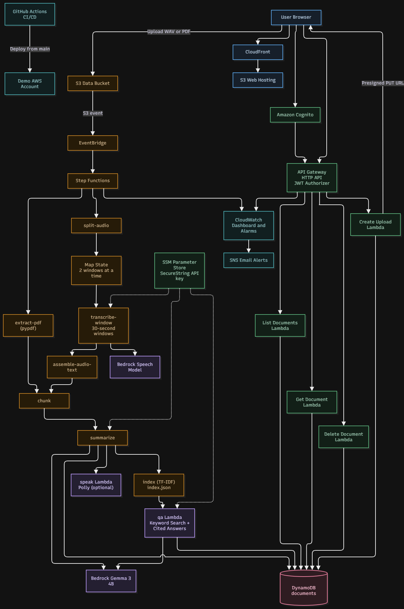

# Serverless Lecture and Document Intelligence Platform

Serverless AWS platform: upload a lecture WAV or a text PDF, get a transcript,
a summary and cited answers. Each user sees only their own data.

## What it does
- Sign up / sign in with Amazon Cognito.
- Upload a lecture recording (16-bit PCM WAV, up to 5 minutes) or a text PDF (up to 20 pages).
- Processing starts automatically: speech-to-text (Voxtral Mini on Bedrock) for audio, or text
  extraction (pypdf) for PDF, then chunking, a summary (Gemma 3 4B on Bedrock) and a TF-IDF keyword index.
- Read the transcript and summary, ask questions and get answers with citations
  (timestamps such as `12:30-13:10` for audio, `p.4` / `pp.4-5` for PDF).
- Optional spoken summary with Amazon Polly. Delete a document and all its files.

## Architecture



```text
Browser (Vite app) --> Cognito (login, ID token)
        |
        +--> HTTP API (JWT authorizer) --> CRUD Lambdas --> DynamoDB documents table
        |                               --> qa / speak Lambdas --> Bedrock, Polly
        +--> presigned PUT --> S3 uploads/ --> EventBridge --> Step Functions pipeline
                parse-event -> split-audio -> transcribe-window (Map) -> assemble-audio-text
                            -> extract-pdf (PDF)
                -> chunk -> summarize -> index -> update-status (DONE / FAILED)
```

15 Lambdas (Python 3.12), one IAM role each. The Bedrock API key lives only in SSM
(`/lecdoc/{stage}/bedrock-api-key`, SecureString). User identity always comes from the JWT `sub` claim,
and every S3 key and DynamoDB item is scoped by that user id.

### API

All routes need `Authorization: Bearer <idToken>`.

| Route | Purpose |
| --- | --- |
| `POST /uploads` | create a document and get a presigned upload URL |
| `GET /documents` | list your documents, newest first |
| `GET /documents/{documentId}` | status, summary and a presigned transcript URL |
| `DELETE /documents/{documentId}` | delete the document and its files |
| `POST /ask` | question over one or all of your documents, answer with citations |
| `POST /speak` | presigned MP3 of the summary (Polly) |

Full contracts (naming, exports, S3 layout, table schema, JSON formats): [docs/contracts.md](docs/contracts.md).

## Repository layout

| Folder | Stack | Owner | Contents |
| --- | --- | --- | --- |
| `infra/` | core, monitoring | M3 | data bucket, table, alerts, dashboard, deploy/destroy scripts, model checks, perf scripts |
| `auth/` | auth | M4 | Cognito user pool, test-user script, token helper |
| `ai/` | ai | M2 | chunk, summarize, index, qa, speak Lambdas |
| `pipeline/` | pipeline | M1 | CRUD and pipeline Lambdas, state machine, EventBridge rule ([README](pipeline/README.md)) |
| `api/` | api | M4 | HTTP API, JWT authorizer, routes |
| `frontend/` | web | M4 | S3 + CloudFront hosting, Vite app in `frontend/app/` |
| `tests/` | | M4 | cross-user isolation tests |
| `samples/` | | M3 | sample WAV and PDF files (plus a scanned PDF that must fail) |
| `docs/` | | all | contracts, report sections, performance, security review, teardown |

## Team
| Member | Role | Owns |
| --- | --- | --- |
| M1 | Backend and pipeline | pipeline/ |
| M2 | AI and data | ai/ |
| M3 | Infra, DevOps, monitoring | infra/, .github/, samples/ |
| M4 | Frontend, security, docs | auth/, api/, frontend/, docs/, tests/ |

## Getting started

Prerequisites: AWS CLI, SAM CLI, Python 3.12, Node 20, `jq`, and a Bedrock API key for your own dev account.

```bash
pip install -r requirements-dev.txt

# checks (same as CI)
ruff check .
pytest -q
cfn-lint $(git ls-files 'infra/*.yaml' '*template.yaml')
```

Deploy to your own dev account (demo is deployed by CI only):

```bash
aws sts get-caller-identity                      # make sure this is YOUR dev account
export BEDROCK_API_KEY=... ALERT_EMAIL=you@example.com
./infra/deploy.sh dev                            # or one stack: ./infra/deploy.sh dev pipeline
TEST_PASSWORD='YourPass123' ./auth/create-test-users.sh dev
```

Stacks deploy in the order core, auth, ai, pipeline, api, web, monitoring. Stage settings
(region, model ids, `skipStacks`) are in `infra/config/<stage>.json`. `infra/build-frontend.sh`
writes `frontend/app/public/config.js` from the stack exports, builds the app and syncs it to the web bucket.
For local frontend work run `npm ci && npm run dev` in `frontend/app/` after creating that `config.js`.

## CI/CD

`.github/workflows/ci.yml` runs ruff, pytest, cfn-lint and a secret scan on every pull request
and push. A push to `main` then deploys the `demo` stage through GitHub OIDC
(`infra/github-oidc.yaml`). The web stack is skipped in demo (`skipStacks`).

## Results

| Metric | Value |
| --- | --- |
| Processing time, audio 1-5 min | about 7-11 s end to end |
| Processing time, PDF 2-20 pages | about 3-5 s end to end |
| API latency (server side) | p50 66 ms, p95 450 ms |
| Cost per document | about $0.007 with Polly, $0.0005-0.0015 without |

Details: [docs/perf/latency.md](docs/perf/latency.md). Security review: [docs/security.md](docs/security.md).
Isolation evidence: [docs/evidence-isolation-w5.txt](docs/evidence-isolation-w5.txt).

## Limits
- Audio must be WAV (convert first: `ffmpeg -i in.mp3 -ac 1 -ar 16000 -c:a pcm_s16le out.wav`), max 5 minutes.
- PDFs must contain real text (no scans), max 20 pages. Frontend blocks files over 50 MB.
- Search is keyword based: a question sharing no words with the text finds nothing.

## Docs
- Contracts: [docs/contracts.md](docs/contracts.md)
- Report: [docs/report/](docs/report/)
- Teardown after grading: [docs/teardown.md](docs/teardown.md)

Never commit secrets or keys.
